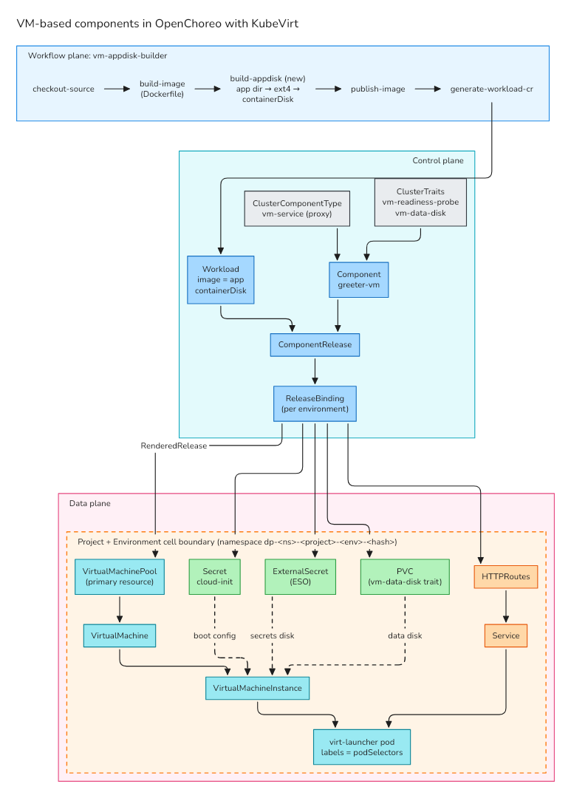

# Proposal: VM-based Component Types in OpenChoreo with KubeVirt

## Context

This has been a common ask from OpenChoreo - how do you bring an existing VM estate, legacy or otherwise, under OpenChoreo's control plane to unify all of your applications within the IDP.

Our only answer to this so far has been either:
1. _no_ - OpenChoreo only supports containerized workloads,
2. Or moving any existing IaC for the VMs to argo workflows on the workflow plane (with no real gain, OpenChoreo's developer experience constructs cannot apply here).

## Can KubeVirt bridge this gap?

Yes. Based on a PoC I've run, it seems that OpenChoreo can natively support VM-based workloads with KubeVirt as of v1.3, bringing VMs under the same component-model and other concepts used in the project.
However, there are some changes we can make to the core to further improve this experience. More details below.

### Aside: What is KubeVirt?

KubeVirt is an open-source virtualization extension and CNCF-graduated project that lets you run and manage virtual machines (VMs) side by side with containers on the same Kubernetes clusters (ie. data planes in OpenChoreo).

  > KubeVirt technology addresses the needs of development teams that have adopted or want to adopt Kubernetes but possess existing Virtual Machine-based workloads that cannot be easily containerized. More specifically, the technology provides a unified development platform where developers can build, modify, and deploy applications residing in both Application Containers as well as Virtual Machines in a common, shared environment.
  >
  > Benefits are broad and significant. Teams with a reliance on existing virtual machine-based workloads are empowered to rapidly containerize applications. With virtualized workloads placed directly in development workflows, teams can decompose them over time while still leveraging remaining virtualized components as is comfortably desired.

(Source: https://kubevirt.io)

## PoC Summary

The goal of this PoC was to evaluate whether KubeVirt can back **VM-based component types** in OpenChoreo while keeping the platform's
developer contract intact: ComponentTypes, Traits, environment-specific secret/config injection via secret references, endpoints, dependencies,
build and deployment pipelines in the workflow plane, and the ontology-driven observability features (logs, metrics, events and traces).

**Verdict:** it works today with the existing extension points - no OpenChoreo code changes needed. A VM component gets
built from source, deployed, configured, promoted and observed the same way a container component does, and rollouts
are zero-downtime as long as it runs 2+ replicas. There are a few rough edges in the core though (health reporting,
the workload type model, config injection, rollouts and storage), which I've listed under
[What needs to change in OpenChoreo](#what-needs-to-change-in-openchoreo).

| Concept | PoC Findings | Status |
|---|---|---|
| ComponentType | `ClusterComponentType vm-service` (`workloadType: proxy`) renders a KubeVirt `VirtualMachinePool` | ✅ |
| Build → deploy | Stock `dockerfile-builder` + one extra step that packages the app as a VM disk image | ✅ |
| Config & secrets | Workload env/files and ESO secrets are delivered to the guest via cloud-init and an attached secrets disk | ✅ |
| Endpoints | VM labels propagate to the launcher pod, so the stock Service + HTTPRoutes just work | ✅ |
| Dependencies | Connection env vars (`GREETER_URL`, ...) land in the guest; VM → VM calls work | ✅ literal values only (see below) |
| Traits | VM-specific traits (readiness probe, data disk) patch the pool like any other resource | ✅ |
| Promotion / env overrides | ReleaseBinding sizing, env, files and trait configs, same ComponentRelease across envs | ✅ |
| Rollouts | Config change replaces VMs one at a time, gated by readiness | ✅ 2+ replicas: zero downtime · ⚠️ 1 replica: ~60 s outage |
| Observability | Logs (serial console), metrics and traces are attributed to the component through pod labels | ✅ with caveats |
| Health / Ready status | VM kinds are reported Healthy as soon as they exist | ❌ needs a core change |
| Persistent data | Trait-created PVC survives VM replacement | ⚠️ single replica only, unless read-write-many is supported by the storage class (not an OpenChoreo limitation) |

_Literal values only:_ a dependency env var either resolves to a plain value, or to a reference to a Secret or
ConfigMap in the data plane. Plain values, like an endpoint's URL, host and port, are written into the guest as is.
References, like a database password from a resource dependency, aren't delivered yet - see
[Config and secret injection](#3-config-and-secret-injection-is-container-shaped-medium).

## How it works



The PoC rests on three choices:

1. **`workloadType: proxy`** - it's the only workload type that accepts a non-built-in kind as the primary resource.
   Builds, endpoints and dependencies aren't gated on workload type, so all we lose is workload-aware readiness and
   restart-on-change (see below).
2. **`VirtualMachinePool`, not `VirtualMachine`** - a pool replaces VMs when their template changes, heals failed ones
   and scales like a Deployment. A plain VM just gets flagged `RestartRequired` and nothing restarts it.
3. **OS disk + app disk** - the platform owns the OS image (a ComponentType parameter), and the build packages the
   app's files as a small disk image, published as a container image. That flows through Workload → ComponentRelease
   → promotion like any other image, and in the guest cloud-init mounts it and systemd starts the app. The catch is
   that the app has to run on that OS (a static binary, or a runtime that's already in the image).

## Can we support non-Containerfile builds?

Yes - and for legacy apps we'll need to. This PoC only uses a Containerfile (dockerfile) to build the app, but in theory, a custom `ClusterWorkflow` can be used to encode any kind of build logic. From the `app-disk` step onwards, it doesn't matter how the source is built.

From least to most legacy:

1. **Native builds with no containerization.** Run the project's own build (`mvn package`, `dotnet publish`, `make`, `ant`, etc) in a
   builder image and feed the output directory straight into the app disk step. The runtime (JDK, Tomcat, .NET) comes
   from the OS image instead, so the platform maintains a few base images like `ubuntu + jdk17 + tomcat` and the app
   disk only carries the WAR or the binaries. 
2. **Pre-built artifacts.** A lot of legacy apps already have a CI that publishes a `.war`, a tarball or an installer to
   Nexus, Artifactory or S3. The workflow just downloads it (with a secret reference for the credentials) and builds the
   app disk. Teams with no CI at all can skip the workflow and provide the Workload themselves, like the
   `greeter-client-vm` component in the PoC.
3. **Existing VM images (lift-and-shift).** This is probably the most common legacy case - a qcow2 or VMDK exported
   from VMware or similar. It can be wrapped as a containerDisk (`FROM scratch` + `ADD disk.qcow2 /disk/`) without CDI,
   or imported with CDI on x86. The OS disk + app disk split doesn't apply here, the image _is_ the app. Building
   these images (Packer, virt-customize) is also possible as a workflow, but needs KVM on the workflow plane.
4. **Windows guests.** KubeVirt runs them on x86 with virtio drivers. They'd need their own ComponentType, since
   `vm-service` assumes cloud-init and systemd - cloudbase-init and a Windows service instead.

The catch is with the runtime config/secrets, not the build. Env vars and secrets only reach the guest if it runs cloud-init (or
cloudbase-init on Windows) if the VM image supports it. In older images, these may not be supported so runtime injection of configs/secrets
could be a limitation. These cases would require baking in credentials at build time - we ofc do this, but it breaks the environment-promotion
model in OpenChoreo.

> #### Terminology
>
> **Guest / host.** In virtualization terms, the _guest_ is the operating system running inside a VM, and the _host_ is the machine running the VM. With KubeVirt, each VM runs as a QEMU process inside a regular pod (the `virt-launcher` pod) on a data plane node. So there are two layers: the pod, which Kubernetes and OpenChoreo can see, and the guest OS inside it, which they can't.
>
> **cloud-init / Ignition.** Tools inside the guest that configure a VM when it boots, from data the platform hands it
> (users, files, systemd units, commands to run). cloud-init is the standard on most Linux cloud images, and is what
> the PoC uses to write the app's env file and config files and to start the app. Ignition does the same job for
> container-focused distros like Fedora CoreOS and Flatcar, but runs once, very early in the first boot. KubeVirt hands
> cloud-init data to the guest as a small attached disk (NoCloud or ConfigDrive format); Ignition is supported too,
> but behind an experimental feature gate. Windows has an equivalent called cloudbase-init. Since all of these only run at boot, changing a VM's
> config means replacing the VM rather than updating it in place.

## What needs to change in OpenChoreo to better support VM-based components

Roughly in priority order.

### 1. Health of non-built-in kinds (high)
Release health is hard-coded for Deployment, StatefulSet, Pod and CronJob - anything else is Healthy as soon as it
exists. So a VM component shows **Ready before the guest has booted and stays that way even if it actually never does**. 

**Proposal:** pluggable health for any kind, e.g. a `healthCheck` CEL expression per resource in the ComponentType
(`status.readyReplicas == spec.replicas` for a pool), or generic evaluation of `status.conditions[Ready]`. 
OR if we decide to make `vm` a first-class workload type (below), we can add this to the hardcoded readiness logic for KubeVirt as the other K8s kinds.

### 2. Workload type model (high)
`workloadType` is a closed enum tied to the built-in kinds, so VM component types have to use the free-for-all `proxy` workload type. 
That means no workload-aware readiness (1 above), no restart-on-change, and the UI shows the component as `proxy/...`.

**Proposal:** a `vm` workload type, backed by KubeVirt's `VirtualMachinePool` (or `VirtualMachine`). The platform
would then know which resource is _the_ workload, and could give it proper readiness, restart-on-change and a VM
label in the UI, the same way it does for `deployment` and other types today.

The catch with introducing a `vm` workload type is that it would require KubeVirt installed in the data planes. This is different to other workload types that are native to Kubernetes.

### 3. Config and secret injection is container-shaped (high)
Workload env/files and the CEL helpers all produce pod-spec fragments. For VMs, the ComponentType has to turn them into
files in the guest with hand-written CEL that builds a cloud-init document. It works, but:
- traits can't add to that document (the data disk trait relies on a naming convention instead),
- values with newlines or quotes are fragile in env-file syntax,
- secrets from **resource dependencies** can't be delivered at all, since they point at data plane Secrets rather than
  secret store refs.

**Proposal:** This requires some further improvement/thinking.
One option would be a neutral "configuration bundle" helper (e.g. `configurations.toFileBundle()` returning path →
content/secret-ref entries, dependency env vars included), plus a structured cloud-init section that Traits can patch.

### 4. Rollouts and persistent data (high)
- **No restart-on-change for non-built-in kinds.** The config hash annotation that restarts workloads on a config change is
  only added for `deployment` and `statefulset`. The PoC computes its own hash in CEL, which has to be kept in sync by
  hand.
- **Secret rotation is never picked up.** Only the secret reference is hashed, and secrets attached as a disk are not
  updated inside a running VM.

**Proposal:** This can be potentially handled by OpenChoreo's controllers if we introduce a `vm` workload type with behaviour that covers these areas.

### 6. Observability for guests (medium)
Logs, metrics and traces do show up according to OpenChoreo's ontology as all telemetry still goes through the KubeVirt's launcher pod and its
labels (OpenChoreo can see this pod). But OpenChoreo has no idea there's a guest:
- app logs only come through the serial console, mixed in with boot output and prefixed in a way that breaks JSON parsing,
- CPU and memory are numbers for the whole VM (the QEMU process), not the app.

**Proposal:** let a ComponentType tell the logs view which container carries the app's output (`guest-console-log`
rather than `compute`), and have the metrics adapter use KubeVirt's `kubevirt_vmi_*` metrics for VM components.

### Low priority issues
- `Workload.container.image` and `workload.yaml` are container-centric names, which doesn't read well for VMs.
- Build runners will need extra tooling (`e2fsprogs`, `libguestfs` + KVM if we want golden image builds). Not an OpenChoreo issue though.
- VM types rely on KubeVirt copying the VM's labels onto the launcher pod, since `podSelectors` is the only selector contract we have.

## Try it

Everything used for the PoC is in [`openchoreo/`](openchoreo/). [SETUP.md](SETUP.md).

---

## Details

<details>
<summary><b>Test environment and local findings</b></summary>

- **Versions:** the full run (all checks below) was on OpenChoreo `latest-dev` (2026-11-11). It was re-run from
  scratch on **v1.3.3** (Helm charts 1.3.3): platform setup, build, deploy, the dependency VM, staging promotion and the
  zero-downtime rollout. Also KubeVirt v1.9.1, k3d (k3s v1.36.1, single node, arm64), Colima 0.8.4 (vz) on an Apple M3 Max.
- **KubeVirt needs `/dev/kvm`; emulation doesn't work for arm64 guests on arm64.** KubeVirt forces
  `host-passthrough` CPU mode on arm64 and libvirt rejects it without KVM (`CPU mode 'host-passthrough' for aarch64
  qemu domain on aarch64 host is not supported by hypervisor`, kubevirt/kubevirt#11917). Colima's nested
  virtualization (vz, M3+, macOS 15+) fixes it. Ubuntu 24.04 then boots to a running app in ~31 s.
- **virt-handler crash-loops on `inotify: too many open files`** with Colima's default limits; raise
  `fs.inotify.max_user_instances`.
- **The bridge network binding fails on Cilium** (`no gateway address found in routes for eth0`); masquerade works.
- **CDI isn't supported on arm64**, so the PoC uses containerDisks and plain PVCs only.
- **Memory:** budget ~1.3–1.5 GiB of node memory per 1 GiB guest (launcher overhead). KubeVirt requests only 100m
  CPU per vCPU by default (`cpuAllocationRatio: 10`).

</details>

<details>
<summary><b>Implementation: platform prerequisites</b> (<code>openchoreo/00-platform/</code>)</summary>

| File | Purpose |
|---|---|
| `kubevirt-cr.yaml` | KubeVirt v1.9.1 CR (operator from the upstream release URL), `useEmulation: false`. |
| `cluster-agent-kubevirt-rbac.yaml` | Extra ClusterRole/binding giving the data-plane agent access to `kubevirt.io` and `pool.kubevirt.io` kinds, without touching the Helm-managed role. |
| `resource-tree-values.yaml` | Control-plane Helm values adding resource-tree rules for KubeVirt kinds. |

**Resource tree.** The release resource tree walks child edges defined in the openchoreo-api config
([docs](https://openchoreo.dev/docs/platform-engineer-guide/resource-tree-rules/)). The built-in rules cover
Deployment, CronJob, Job and ExternalSecret only, so without new rules the tree stops at `VirtualMachinePool`.
KubeVirt sets controller `ownerReferences` on every hop, so the plain owner-reference matcher is enough:

```
VirtualMachinePool (pool.kubevirt.io/v1beta1)          <- rendered root
└─ VirtualMachine (kubevirt.io/v1)                      ownerRef: VirtualMachinePool
   └─ VirtualMachineInstance (kubevirt.io/v1)           ownerRef: VirtualMachine
      └─ Pod virt-launcher-* (v1)                       ownerRef: VirtualMachineInstance
VirtualMachine (kubevirt.io/v1)                          <- second rule, for types that render a bare VM
└─ VirtualMachineInstance → Pod
```

Applying it is a control-plane `helm upgrade --reuse-values` (see SETUP.md). Notes from doing it:
- openchoreo-api validates the rules at startup and exits on a bad one.
- The authz bootstrap Job is a post-upgrade hook, so it runs again (it is idempotent).
- On a `latest-dev` install, rebuild the installed chart from the Helm release secret rather than pulling
  `latest-dev` again, which could bring unrelated template changes.
- Nodes in the tree have the same "exists = Healthy" status as the release (gap 1).

</details>

<details>
<summary><b>Implementation: build workflow</b> (<code>openchoreo/01-workflow/</code>)</summary>

- `vm-appdisk-build-cwft.yaml`: Argo `ClusterWorkflowTemplate vm-appdisk-build`. It loads the built image tarball,
  copies `APP_DIR` (default `/app`) out of it, runs `mkfs.ext4 -L ocapp -d`, wraps the result as
  `FROM scratch` / `ADD --chown=107:107 app.img /disk/`, and saves it under the same tag so the stock `publish-image`
  step pushes it. The PoC installs `e2fsprogs` at runtime; it should be baked into the runner image.
- `vm-appdisk-builder.yaml`: `ClusterWorkflow` identical to the stock `dockerfile-builder` (verified against 1.3.3)
  plus a `vm.appDir` parameter and the `build-appdisk` step between build and publish. The repo's `workload.yaml`
  is honoured as usual (endpoints, dependencies).

</details>

<details>
<summary><b>Implementation: ComponentType <code>vm-service</code></b> (<code>openchoreo/02-component-type/</code>)</summary>

Resources rendered per environment:
- `virtualmachinepool`: replicas, vCPUs and memory from `environmentConfigs`; VM labels = `metadata.podSelectors`;
  masquerade interface exposing the endpoint ports; disks for the OS, app, cloud-init and (when there are secrets) secrets.
- `cloudinit`: Secret with `userdata` built in CEL:
  - `/etc/openchoreo/app.env`: config env vars + literal dependency env vars (systemd `EnvironmentFile` syntax);
  - config files at `<mountPath>/<key>`;
  - `openchoreo-bootstrap` script + unit (runs every boot): mounts the app disk read-only at `/opt/app` and the
    secrets disk, writes `/etc/openchoreo/secret.env`, installs secret files with mode 0600, formats and mounts data disks;
  - `openchoreo-app.service`: runs `parameters.startCommand` (or the Workload's command + args), `Restart=always`,
    stdout/stderr to journal and serial console.
- `secrets-external`: one `ExternalSecret` (the data plane's secret store) for all secret env vars and files.
- `service`, `httproute-external`, `httproute-internal`: identical to the stock `service` type.
- `openchoreo.dev/vm-config-hash` annotation on the VM template: a hash of config values, secret refs, dependency
  values, command/args and a `guest-contract/N` marker. Any change alters the template, so the pool replaces the VMs.
  The cloud-init template text itself isn't hashed, so bump `guest-contract/N` when changing it, or running VMs keep
  their old unit files.

**Guest contract** (what the OS image must provide): cloud-init (NoCloud), systemd, ext4 and iso9660 support, and
`/dev/disk/by-id` links. Ubuntu, Fedora and Debian cloud containerDisks qualify. Disk serials: `ocapp` (app),
`ocsecrets` (secrets), `ocd-<instance>` (data disks, ≤ 20 chars).

</details>

<details>
<summary><b>Implementation: traits and sample app</b> (<code>openchoreo/03-traits/</code>, <code>04-app/</code>, <code>05-zero-downtime-test/</code>)</summary>

- `vm-readiness-probe`: adds an HTTP readiness probe to the VM. KubeVirt copies it to the launcher pod (adding 10 s to
  the initial delay), so Service endpoints follow guest readiness. Given gap 1, this is the only real traffic gate.
- `vm-data-disk`: creates a PVC and attaches it as a disk, mounted at `/mnt/<instanceName>`. Data survives VM
  replacement. Single replica only: every replica attaches the same PVC, and QEMU's image lock refuses the second
  VM (`Failed to get "write" lock`), which avoids corruption but leaves that VM failed.
- The stock traits (`persistent-volume-claim`, `health-probes`, HPA/VPA) target Deployment paths and don't apply to
  VMs; VM traits are authored separately, but the trait model itself works unchanged.
- Sample app (`04-app/`): project `vm-poc`; `greeter-vm` built from
  [`openchoreo/sample-workloads/service-go-greeter`](https://github.com/openchoreo/sample-workloads) with both traits,
  a SecretReference to OpenBao, and dev/staging bindings with env, file, secret, sizing and OTLP overrides;
  `greeter-client-vm`, a second VM that depends on greeter-vm's endpoint.
- `05-zero-downtime-test/`: `greeter-vm-ha`, a stateless 2-replica copy used for the rollout test.

</details>

<details>
<summary><b>Observability details</b></summary>

OpenChoreo attributes all signals through pod labels (component, project and environment uids). The VM template
carries `metadata.podSelectors`, KubeVirt copies them onto the launcher pod, so every signal from that pod lands on
the right component and environment.

| Signal | How it's collected | VM outcome |
|---|---|---|
| Logs | fluent-bit tails all container logs into OpenSearch | The launcher pod has two log streams: `compute` (libvirt/QEMU noise) and `guest-console-log` (the guest's serial console, on by default in KubeVirt 1.9). With `StandardOutput=journal+console` in the app unit, app lines appear there as `[  33.12] go-greeter[1121]: {json…}`, alongside boot and cloud-init output. Viewing them in the OpenChoreo UI wasn't checked. |
| Metrics | cAdvisor CPU/memory joined with `kube_pod_labels`; requests/limits from kube-state-metrics | Attributed correctly. Values are for the whole VM (≈695 MiB working set for a 1 GiB guest). Memory climbs towards the guest size and doesn't shrink when the app frees memory. |
| Traces | OTel collector with `k8sattributes`, matching on the connection's source IP | Masquerade networking makes guest traffic leave from the launcher pod IP, so spans get the pod's labels. The app still needs `OTEL_EXPORTER_OTLP_ENDPOINT`, as for containers. Readiness probes produce `GET /readyz` spans too. |
| Gateway metrics | Gateway / Cilium, by pod IP | Unchanged. |

Better options for guest logs: an in-guest log shipper with component labels from cloud-init, or a dedicated
virtio-serial/vsock channel for app logs. For metrics, KubeVirt's `kubevirt_vmi_*` series (guest CPU, memory,
network, disk) would need a ServiceMonitor and adapter support.

Not VM-specific: on the `latest-dev` install, OpenCost also exported kube-state-metrics-style series, so every pod
had duplicate `kube_pod_labels` and the adapter's resource numbers were doubled. The v1.3.3 install has no OpenCost.

</details>

<details>
<summary><b>Full results</b></summary>

Run on `latest-dev` unless marked otherwise. Guest checks were done over the serial console with the
`debugPassword` set in the binding.

| # | Check | Result |
|---|---|---|
| 1 | KubeVirt v1.9.1 on k3d | ✅ after raising inotify limits; node advertises `devices.kubevirt.io/kvm: 1k` with nested virtualization. Also on v1.3.3. |
| 2 | Guest boot | ❌ under emulation. ✅ under KVM: cloud-init done and app started at ~31 s. |
| 3 | Admission of `vm-service`, traits, workflow | ✅ the webhook type-checks all the CEL. Also on v1.3.3. |
| 4 | Build (`vm-appdisk-builder`) | ✅ 2m40s, all 5 steps; the generated Workload carries the app containerDisk and the repo's endpoints. Also on v1.3.3 (~2.5 min). |
| 5 | autoDeploy → release → data plane | ✅ pool, cloud-init Secret, ExternalSecret, Service, HTTPRoute and PVC rendered and applied. Also on v1.3.3. |
| 6 | Endpoints | ✅ gateway → HTTPRoute → Service → launcher pod → guest: `Hello, Stranger!`. |
| 7 | Config injection | ✅ env values in `/etc/openchoreo/app.env` and in the app process env; config file written; app disk read-only at `/opt/app`. |
| 8 | Secret injection (ESO) | ✅ OpenBao value reaches the app process env; secret file installed with mode 0600. A missing secret blocks the VM from starting, like a pod. |
| 9 | Traits | ✅ readiness gates the endpoints; data disk formatted on first boot, and a file survived VM deletion and recreation. |
| 10 | Dependencies | ✅ the client VM's `app.env` has `GREETER_URL`/`HOST`/`PORT`; `curl $GREETER_URL` from inside it returns `Hello, client-vm!`. Client VM also deployed and running on v1.3.3. |
| 11 | Env sizing / replicas | ✅ replicas, vCPUs and memory follow the binding; replicas 0 scales the pool in. |
| 12 | Ready status | ❌ binding Ready while the VM was still scheduling; staging Ready within 10 s, before any VM booted, and still Ready with one of two VMs failed. |
| 13 | Pool stability | ✅ no reconcile churn across agent re-applies. |
| 14 | Rollout on config change | ✅ binding or ComponentType changes replace the VM with the new config. 1 replica: ~60 s of 503s. Rebuild-triggered rollout not tested (it changes the template the same way). |
| 15 | Promotion to staging | ✅ same ComponentRelease, staging config, own PVC and ExternalSecret: `Hello, staging!`. Promotion also applied on v1.3.3. |
| 16 | Replicas > 1 with a data disk | ❌ second VM fails on QEMU's write lock; the pool removed the failed VM on scale-in. |
| 17 | Logs | ✅ app stdout/stderr in `guest-console-log`, with a kernel-timestamp prefix. |
| 18 | Metrics | ✅ metrics adapter returns CPU/memory usage, requests and limits for the component. |
| 19 | Traces | ✅ tracing adapter returns the component's spans by component/environment uid. |
| 20 | Zero-downtime rollout (v1.3.3) | ✅ `greeter-vm-ha`, 2 replicas, readiness probe every 2 s, no data disk. A config change replaced both VMs one at a time while curl hit the gateway ~7 req/s: **2,005 requests over 4.5 min, all 200**. VM-1 stopped 05:00:42 → new one Ready 05:02:54 → only then VM-0 stopped (05:02:58) → Ready 05:04:34. Not tested: concurrent or long-lived connections, multiple nodes, in-flight requests during guest shutdown under load. |

</details>

<details>
<summary><b>Other observations</b></summary>

- A Project applied with kubectl gets a ProjectRelease but no ProjectReleaseBindings, so the data-plane namespace
  doesn't exist until one is created per environment. Not VM-specific.
- ProjectReleases have no project label; read the generated name from the Project's `status.latestRelease.name`.
- The secrets disk uses the env var name (`API_KEY`) as the file name, not the SecretReference key (`api-key`),
  because the CEL context exposes the env name plus the remote ref.
- Comments inside CEL `${…}` blocks must use `//`, not `#`.
- Applying a binding manifest over an autoDeploy-created ReleaseBinding warns about a missing
  `last-applied-configuration` annotation; it's harmless.

</details>
